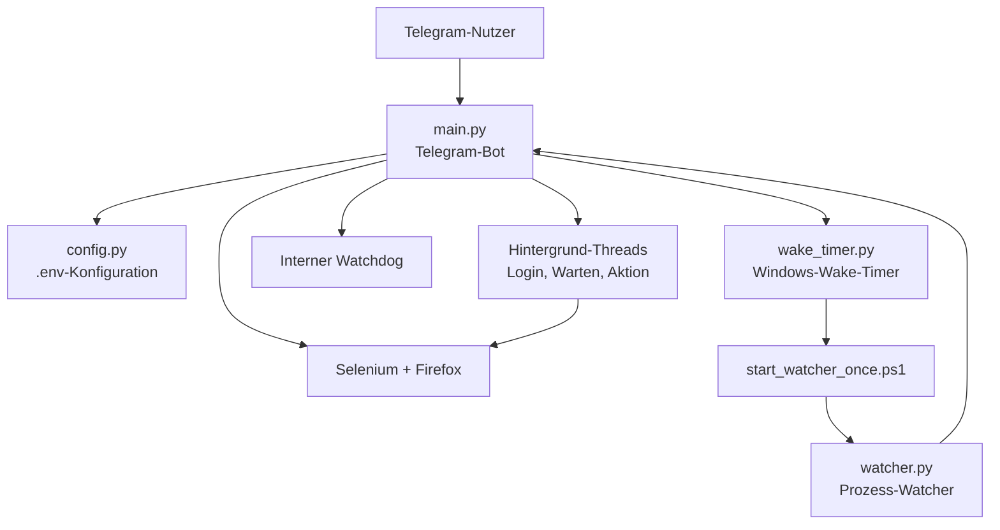

# Session Automation Bot

Telegram-gesteuerter Python-Bot zur zeitgesteuerten Automatisierung von Login- und Logout-Prozessen mit Selenium unter Windows.

## Projektübersicht

Der **Session Automation Bot** ist ein persönliches Lern- und Portfolio-Projekt zur zeitgesteuerten Browserautomatisierung. Die Bedienung erfolgt über Telegram; die Browsersteuerung übernimmt Selenium mit Firefox.

Die aktuelle Implementierung automatisiert Login-, Logout- und weitere konfigurierte Abläufe in einer konkret integrierten Webanwendung. Das Projekt erhebt keinen Anspruch auf Unterstützung beliebiger Websites.

## Motivation

Ziel des Projekts ist eine robuste lokale Automatisierung für zeitabhängige Benutzer-Sitzungen. Der Schwerpunkt liegt auf der praktischen Integration mehrerer Komponenten:

- asynchrone Telegram-Kommunikation;
- Selenium-basierte Browsersteuerung;
- nebenläufige Warte- und Überwachungsprozesse;
- sichere Konfiguration über Umgebungsvariablen;
- Windows-spezifische Energie- und Autostartfunktionen.

## Funktionsweise

Die Anwendung wird über einen Telegram-Bot gesteuert. Der Benutzer wählt die gewünschte Aktion über interaktive Schaltflächen aus und erhält Status- und Ergebnisnachrichten direkt im selben Telegram-Chat.

### 1. Automatisierter Login und Check-in

1. Über `/start` wählt der Benutzer **Check-in**.
2. Der Bot startet Firefox im Headless-Modus und öffnet die konfigurierte Zieladresse.
3. Selenium findet die Login-Felder, trägt die konfigurierten Zugangsdaten ein und verarbeitet den Login einschließlich optionaler Hinweise oder Bestätigungen.
4. Anschließend führt der Bot den im aktuellen Zielsystem implementierten Check-in-Ablauf aus.
5. Nach erfolgreicher Ausführung sendet der Bot eine Telegram-Nachricht mit der aktuellen lokalen Zeit und der vom Zielsystem gelesenen Startzeit. Falls der Check-in bereits aktiv ist, wird dies ebenfalls gemeldet.

### 2. Zeitgesteuerter Logout

1. Über `/start` wählt der Benutzer **Abmelden Test** oder **Abmelden Real**.
2. Die gewünschte Zeit wird über eine vordefinierte Schaltfläche ausgewählt: in 1, 2 oder 5 Minuten oder zu einer festen Uhrzeit. Freie Zeiteingaben sind aktuell nicht vorgesehen.
3. Der Bot startet Firefox, führt den Login aus und sucht die für den gewählten Ablauf benötigte Ziel-Schaltfläche.
4. Danach wartet der Hintergrundprozess bis zur festgelegten Zielzeit.
5. Während der Wartezeit sendet der Bot automatisch Telegram-Zwischenmeldungen mit der verbleibenden Zeit.
6. Zum Zielzeitpunkt führt Selenium den Logout-Klick aus.
7. Im Realmodus versucht der Bot, die vom Zielsystem angezeigte Endzeit auszulesen und zusammen mit der Erfolgsmeldung zu senden. Im Testmodus wird eine allgemeine Erfolgsbestätigung gesendet.
8. Anschließend wird der Browser geschlossen und der Bot meldet sich für einen neuen Vorgang bereit.

### 3. Status, Abbruch und Prozessüberwachung

- `/status` zeigt den Zustand von Bot, Browser, Watchdog, Warteprozess, Zielzeit und Akku.
- `/reset` bricht einen laufenden Vorgang ab, schließt den Browser und setzt den internen Zustand zurück.
- Ein interner Watchdog überwacht den Browser und bereinigt nicht mehr erreichbare Instanzen.
- `watcher.py` überwacht den Hauptprozess und startet ihn nach einem unerwarteten Ende erneut.

### 4. Windows-Energieverwaltung und Wake-Timer

- `/sleep` fragt nach einer Bestätigung und versetzt den Computer standardmäßig in den Ruhezustand. Falls dieser nicht ausgeführt werden kann, wird Standby versucht.
- `/sleep_wake` erstellt nach einer Bestätigung einen Wake-Timer und eine Windows-Aufgabe, bevor der Computer in den Standby-Modus versetzt wird.
- Für feste Weckzeiten wird der Computer technisch zehn Minuten früher geweckt, damit der Bot rechtzeitig starten kann.

Die Anwendung fährt den Computer nicht vollständig herunter. Sie verwendet Windows-Ruhezustand oder Standby und kann ihn über Windows-Wake-Mechanismen wieder aufwecken.

## Funktionen

- Auswahl der Aktion über Telegram-Inline-Schaltflächen.
- Automatischer Login in Firefox im Headless-Modus.
- Zusätzlicher Check-in-Ablauf der aktuell integrierten Webanwendung.
- Logout-Testmodus zum Auslösen der konfigurierten Ziel-Schaltfläche.
- Zeitgesteuerter Logout-Ablauf.
- Statusbericht mit Browser-, Watchdog-, Warte- und Akkustatus.
- Abbruch und Aufräumen eines laufenden Vorgangs über `/reset`.
- Überwachung des Browsers durch einen internen Watchdog.
- Neustart des Bots durch `watcher.py`, wenn der Hauptprozess beendet wurde.
- Windows-Standby oder Ruhezustand über Telegram-Bestätigung.
- Native Windows-Wake-Timer und geplante Windows-Aufgabe für das automatische Aufwachen.
- Schutz vor mehreren gleichzeitig laufenden Bot- und Watchdog-Instanzen.

## Technologien

| Technologie | Verwendung |
|---|---|
| Python 3.10+ | Anwendung, Nebenläufigkeit und Zeitsteuerung |
| `python-telegram-bot` | Telegram-Bot und Inline-Interaktionen |
| Selenium WebDriver | Automatisierung von Firefox |
| Firefox | Zielbrowser für die konkret integrierte Webanwendung |
| `psutil` | Prozess- und Akkustatus sowie Watchdog-Funktionen |
| `requests` | Direkte Telegram-Benachrichtigungen aus Hintergrundprozessen |
| PowerShell | Windows-Aufgaben, Standby und Wiederanlauf |
| Windows API über `ctypes` | Mutex-Schutz und native Wake-Timer |

## Architektur



`main.py` verarbeitet Telegram-Updates und koordiniert Browser- und Hintergrundprozesse. `watcher.py` startet den Bot und überwacht den Hauptprozess. `wake_timer.py` wartet auf einen nativen Windows-Wake-Timer und startet danach den Wiederanlauf über PowerShell. Laufzeitstatus und Logs werden lokal geschrieben und nicht versioniert.

## Projektstruktur

```text
.
├── config.py                         # Lädt und validiert .env-Werte
├── main.py                           # Telegram-Bot und Kernlogik
├── watcher.py                        # Überwachung und Neustart des Bots
├── wake_timer.py                     # Native Windows-Wake-Timer
├── start_watcher_once.ps1            # Wiederanlauf nach dem Aufwachen
├── install_bot_watcher_task.ps1      # Optionaler Windows-Autostart
├── start_bot_watcher_hidden.vbs      # Optionaler unsichtbarer Start
├── requirements.txt                  # Python-Abhängigkeiten
├── .env.example                      # Sichere Konfigurationsvorlage
└── .github/workflows/ci.yml          # Syntaxprüfung in GitHub Actions
```

Die lokale Altversion in `PROJECT_AUS/` wird nicht veröffentlicht und ist über `.gitignore` ausgeschlossen.

## Voraussetzungen

- Windows mit PowerShell und Windows Task Scheduler.
- Python 3.10 oder neuer.
- Firefox.
- Eine erreichbare Instanz der konkret integrierten Webanwendung.
- Ein Telegram-Bot-Token und die eigene numerische Telegram-Chat-ID.
- Eine funktionierende Selenium-WebDriver-Umgebung für Firefox.

Die Anwendung ist derzeit bewusst auf Windows ausgerichtet, weil sie Windows-APIs, PowerShell und geplante Aufgaben verwendet.

## Installation

```powershell
git clone <REPOSITORY-URL>
cd session-automation-bot

py -3 -m venv .venv
.\.venv\Scripts\Activate.ps1
python -m pip install --upgrade pip
python -m pip install -r requirements.txt

Copy-Item .env.example .env
```

Anschließend `.env` mit den eigenen Werten ausfüllen. Die Datei `.env` darf niemals veröffentlicht werden.

Optional kann der Watchdog beim Windows-Login eingerichtet werden:

```powershell
.\install_bot_watcher_task.ps1
```

Wenn Python nicht über `PATH` gefunden wird, kann der Pfad explizit angegeben werden:

```powershell
.\install_bot_watcher_task.ps1 -PythonExe "C:\Pfad\zu\python.exe"
```

## Konfiguration

Die Konfiguration wird aus `.env` gelesen:

| Variable | Beschreibung |
|---|---|
| `BOT_TOKEN` | Token des Telegram-Bots |
| `ALLOWED_CHAT_ID` | Einzige Chat-ID, die den Bot steuern darf |
| `DEFAULT_URL` | Startadresse der konkret integrierten Webanwendung |
| `DEFAULT_LOGIN` | Login für die Webanwendung |
| `DEFAULT_PASSWORD` | Passwort für die Webanwendung |
| `WATCHDOG_EVERY_SECONDS` | Prüfintervall des internen Watchdogs |

## Verwendung

Manueller Start des Watchdogs:

```powershell
python watcher.py
```

Verfügbare Telegram-Befehle:

- `/start` — Aktion und Ausführungszeit auswählen.
- `/status` — Status von Bot, Browser, Watchdog, Warteprozess und Akku anzeigen.
- `/reset` — laufenden Vorgang abbrechen und Browser schließen.
- `/sleep` — Windows-Standby oder Ruhezustand nach Bestätigung ausführen.
- `/sleep_wake` — Wake-Timer konfigurieren und den Computer in den Standby versetzen.

Freie Zeiteingaben sind absichtlich deaktiviert. Die verfügbaren Zeiten werden über Inline-Schaltflächen ausgewählt.

## Tests und Checks

Eine automatisierte End-to-End-Testumgebung ist derzeit nicht vorhanden, da die Kernfunktionen eine reale Zielanwendung, Firefox, Windows-Energieverwaltung und Telegram-Zugangsdaten benötigen.

Die unabhängigen Unit-Tests können ohne externe Dienste ausgeführt werden:

```powershell
python -m unittest discover -s tests -v
```

Sie prüfen Konfigurationsvalidierung, Zeitplanung, Abbruchzustände und die Maskierung sensibler Diagnosedaten.

Die lokale Syntaxprüfung lautet:

```powershell
python -m py_compile config.py main.py watcher.py wake_timer.py
```

GitHub Actions installiert die festgelegten direkten Abhängigkeiten und führt die Unit-Tests, die Python-Syntaxprüfung sowie eine Prüfung der PowerShell-Skripte aus. Es werden keine echten Zugangsdaten und keine externen kostenpflichtigen Dienste benötigt.

## Sicherheit und Datenschutz

- Zugangsdaten und Bot-Token werden ausschließlich über `.env` geladen.
- `.env`, Logs, Laufzeitstatus und Python-Cache-Dateien sind in `.gitignore` ausgeschlossen.
- Der Bot akzeptiert Befehle nur von `ALLOWED_CHAT_ID`.
- Es werden keine Datenbanken verwendet.
- Browser- und Telegram-Kommunikation greifen auf externe Dienste zu und benötigen eine Netzwerkverbindung.
- Fehlermeldungen und Statusinformationen werden vor der Übertragung und dem Logging um Token, Passwörter, Cookies, Session-Werte und persönliche Windows-Pfade bereinigt.

## Bekannte Einschränkungen

- Die Anwendung ist Windows-spezifisch.
- Selenium-Selektoren hängen vom aktuellen Aufbau der konkret integrierten Webanwendung ab.
- Für die tatsächliche Browserautomatisierung sind gültige Zugangsdaten und eine erreichbare Zielanwendung erforderlich.
- Es gibt noch keine automatisierten End-to-End-Tests.
- Die Anwendung ist für eine einzelne konfigurierte Telegram-Chat-ID ausgelegt.
- Die direkten Paketversionen sind festgelegt; transitive Abhängigkeiten werden durch `pip` aufgelöst.

## Weiterentwicklung

- Unit-Tests für Zeitberechnung, Zustandswechsel und Konfigurationsvalidierung ergänzen.
- Selenium-Selektoren und externe URLs in eine eigene Konfigurationsschicht auslagern.
- Abhängigkeiten nur nach einer erfolgreichen Kompatibilitätsprüfung aktualisieren.
- Strukturierte, redigierte Logs statt frei formulierter Laufzeitmeldungen einführen.
- Die Telegram-Texte über eine zentrale Lokalisierung verwalten.
- Eine sichere Testumgebung mit simulierten Telegram- und Browser-Abhängigkeiten ergänzen.

## Lizenz

Für dieses Projekt wurde noch keine Lizenz festgelegt. Eine Lizenz sollte vor der Veröffentlichung bewusst ausgewählt und separat bestätigt werden.
